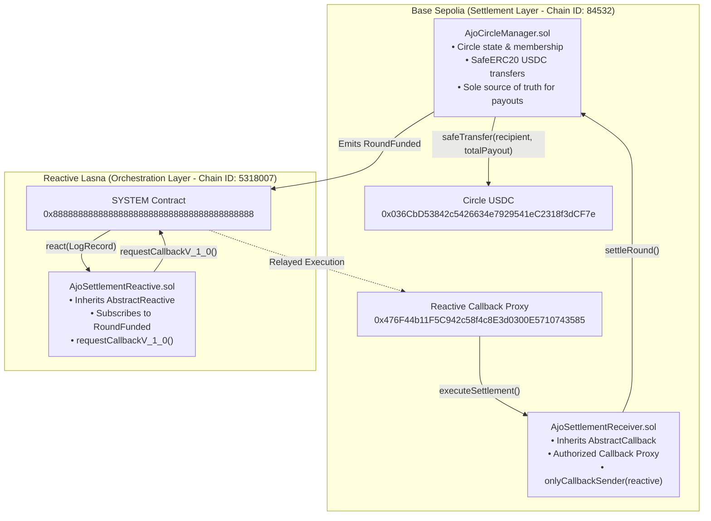

# AjoFlow

> **Autonomous, Zero-Maintenance Rotating Savings & Credit Protocol powered by Reactive Omni**

Built for the **Reactive Omni Buildathon** (Track: *Set It and Forget It*) on [DoraHacks](https://dorahacks.io/hackathon/reactive-omni-buildathon/detail).

---

## 1. Problem & Solution

### The Problem
Traditional Rotating Savings and Credit Associations (ROSCAs, known globally as *Ajo*, *Esusu*, *Tanda*, or *Chit funds*) help billions of people save collectively. However, existing implementations suffer from:
- **Centralized Coordinator Risk:** The circle manager can abscond with funds, delay payouts, or charge arbitrary fees.
- **Fragile Web3 Automation:** Smart contract ROSCAs previously depended on centralized off-chain keepers (e.g. Gelato, Chainlink Automation) or manual triggers, requiring recurring fees, server maintenance, and multi-signature monitoring.

### The Solution: AjoFlow
AjoFlow implements fully autonomous on-chain ROSCAs using **Reactive Omni**:
1. Members pool fixed amounts of verified Circle USDC on Base Sepolia.
2. An autonomous Reactive contract on Reactive Lasna monitors deposit milestones directly from event logs.
3. Upon cycle round completion, the Reactive contract automatically dispatches a cross-chain callback to execute payouts to the scheduled recipient without human or centralized keeper intervention.

---

## 2. Target Users

- **Collaborative Savers:** Communities and peer circles seeking transparent, trustless rotating savings pools.
- **DeFi Micro-savers:** Users wanting automated capital accumulation in stablecoins (Circle USDC) on low-fee L2 networks (Base Sepolia).
- **Decentralized Finance Enthusiasts:** Developers and users looking for pure *set-and-forget* financial automations.

---

## 3. Why Reactive Network is Essential

In traditional Ethereum smart contracts, logic cannot execute on its own without an external transaction (EOA) initiating and paying gas. 

With **Reactive Omni**:
- **Inversion of Control:** The smart contract natively listens to event logs across chains.
- **Autonomous Feedback Loop:** Once subscribed, the contract reacts to events and triggers cross-chain callbacks when conditions are met.
- **Sub-Second Finality:** Reactive Omni's CometBFT consensus provides instant finality (~1 second block times), ensuring rapid execution for time-sensitive rotation schedules.

---

## 4. Architecture & Three-Contract Separation

AjoFlow strictly enforces a three-contract decoupled architecture to adhere to Reactive Omni inheritance rules:



| Contract | Network | Base Class | Responsibilities |
| :--- | :--- | :--- | :--- |
| **`AjoCircleManager.sol`** | Base Sepolia (`84532`) | `ReentrancyGuard` | Canonical circle accounting, SafeERC20 transfers, payout recipient calculation. Zero cross-chain dependencies. |
| **`AjoSettlementReceiver.sol`** | Base Sepolia (`84532`) | `AbstractCallback` | Authenticated receiver for Reactive Callback Proxy (`0x476F44b1...`). Forwards settlement signals to manager. |
| **`AjoSettlementReactive.sol`** | Reactive Lasna (`5318007`) | `AbstractReactive` | Event subscriber for `RoundFunded` logs. Issues `requestCallbackV_1_0()` with `address(0)` placeholder. |

---

## 5. Verified Network Configuration

All live network RPC endpoints and contracts were inspected and verified via read-only RPC calls during Phase 1 reconnaissance.

### Base Sepolia (Chain ID `84532`)
- **RPC Endpoint:** `https://sepolia.base.org` (Verified active)
- **Settlement Token:** Circle USDC at `0x036CbD53842c5426634e7929541eC2318f3dCF7e` (6 decimals verified)
- **Callback Proxy:** `0x476F44b11F5C942c58f4c8E3d0300E5710743585` (Bytecode verified)
- **Block Explorer:** [https://sepolia.basescan.org](https://sepolia.basescan.org)

### Reactive Lasna (Chain ID `5318007`)
- **RPC Endpoint:** `https://lasna-rpc.rnk.dev/` (Verified active)
- **System Contract:** `0x8888888888888888888888888888888888888888` (Bytecode verified)
- **Block Explorer:** [https://lasna.reactscan.net](https://lasna.reactscan.net)

---

## 6. Frontend User Interface Design

The frontend user interface follows the production reference design documented in [`docs/architecture/ui-reference.png`](docs/architecture/ui-reference.png):
- **Circle Discovery & My Groups:** High-level summary of active circles, contribution progress bars (e.g. 2 of 3 paid), and upcoming deadlines.
- **Cycle Details Dashboard:** Balance display, dynamic round progress stepper (rounds 1 through 3), and draw schedules.
- **Member Transparency View:** Granular member status indicators (*Paid*, *Late*, *Pending*).

---

## 7. Technology Stack & Pinned Dependencies

- **Primary Toolchain:** Hardhat 3.22 (ESM) + Solc `0.8.29`
- **Smart Contracts:** Solidity `^0.8.29`
- **Reactive Library:** Reactive Omni (`reactive-lib-omni` pinned to commit `3ade0dcf1d27e67e5783ef807e73a1b9e0c0cce8` / tag `v0.1.0`)
- **Token Security:** OpenZeppelin Contracts `^5.6.1` (`SafeERC20`, `IERC20`, `ReentrancyGuard`)
- **Linting & Formatting:** Solhint `^6.2.5`, Prettier `^3.10.1` (`prettier-plugin-solidity`)
- **Settlement Token:** Official Circle USDC (6 decimals)

---

## 8. Setup & Compilation

```bash
# Clone the repository
git clone https://github.com/JimmyOgb/AjoFlow.git
cd AjoFlow

# Install pinned dependencies
npm install

# Compile contracts
npx hardhat compile

# Run static analysis
npx solhint "contracts/src/**/*.sol"

# Check code formatting
npx prettier --check "contracts/src/**/*.sol" "reactive/src/**/*.sol"
```

---

## 9. Callback Funding & Debt Model

- **Lasna Reserves:** `AjoSettlementReactive` must maintain native REACT balance to pay `SYSTEM` for `react()` execution.
- **Base Sepolia Reserves:** `AjoSettlementReceiver` must maintain Base Sepolia ETH balance to pay the Callback Proxy for cross-chain execution.
- **Any Debt Halts Callbacks:** Both contracts feature permissionless `receive() external payable` functions to allow anyone to top up gas reserves and clear any outstanding debt.
- **Idempotent Retries:** Duplicate or retried callbacks cannot result in duplicate payouts; the manager enforces atomic state changes prior to token disbursement.

---

## 10. Actual Implementation Status

> [!IMPORTANT]
> **Contracts are NOT deployed yet.** All contract addresses and transaction hashes remain strictly **PENDING** until live deployment receipts are verified on-chain in Phase 3.

- [x] **Phase 1: Repository Creation, Technical Reconnaissance and Foundation** (Completed)
  - [x] Public repository created under authenticated account (`JimmyOgb/AjoFlow`)
  - [x] Live read-only RPC reconnaissance on Base Sepolia and Reactive Lasna
  - [x] Circle USDC and System Contract bytecode confirmed
  - [x] Architectural documentation and security specifications completed
- [x] **Phase 2: Technical Design, Dependency Setup & Verification** (Completed)
  - [x] Official Reactive Omni library pinned to commit `3ade0dcf1d27e67e5783ef807e73a1b9e0c0cce8` (v0.1.0)
  - [x] Hardhat toolchain with Solc `0.8.29` verified and compiling
  - [x] Three-contract architecture specified and compilation-verified
  - [x] Static analysis (Solhint) and code formatting (Prettier) verified
  - [x] Granular 3-tier testing strategy and frontend integration contracts defined
- [ ] **Phase 3: Contract Implementation & Live Testnet Verification** (Pending Phase 2 Approval)
- [ ] **Phase 4: Frontend Integration, Video Demonstration & Final Submission** (Pending Phase 3)

### Verified Addresses and Hashes Status:
- `AjoCircleManager` (Base Sepolia): `PENDING`
- `AjoSettlementReceiver` (Base Sepolia): `PENDING`
- `AjoSettlementReactive` (Reactive Lasna): `PENDING`
- Origin Deposit Transaction Hash: `PENDING`
- Lasna Reaction Transaction Hash: `PENDING`
- Callback Execution Transaction Hash: `PENDING`

---

## 11. Three-Minute Demo Plan

1. **Minute 0:00 - 0:45 (Problem & Architecture):** Explain the vulnerability of traditional ROSCAs and present the AjoFlow architecture showing how Reactive Omni automates savings circles.
2. **Minute 0:45 - 1:45 (Live Interaction & Deposit):** Connect wallet on Base Sepolia, display the group dashboard, and deposit USDC for the current round.
3. **Minute 1:45 - 2:30 (Autonomous Reactive Execution):** Show the Lasna block explorer capturing the contribution event and automatically triggering `requestCallbackV_1_0`.
4. **Minute 2:30 - 3:00 (On-Chain Settlement Confirmation):** Verify the callback execution on Base Sepolia and the automated USDC payout disbursement to the recipient without any manual keeper interaction.

---

## 12. License

Distributed under the MIT License. See [`LICENSE`](LICENSE) for details.
