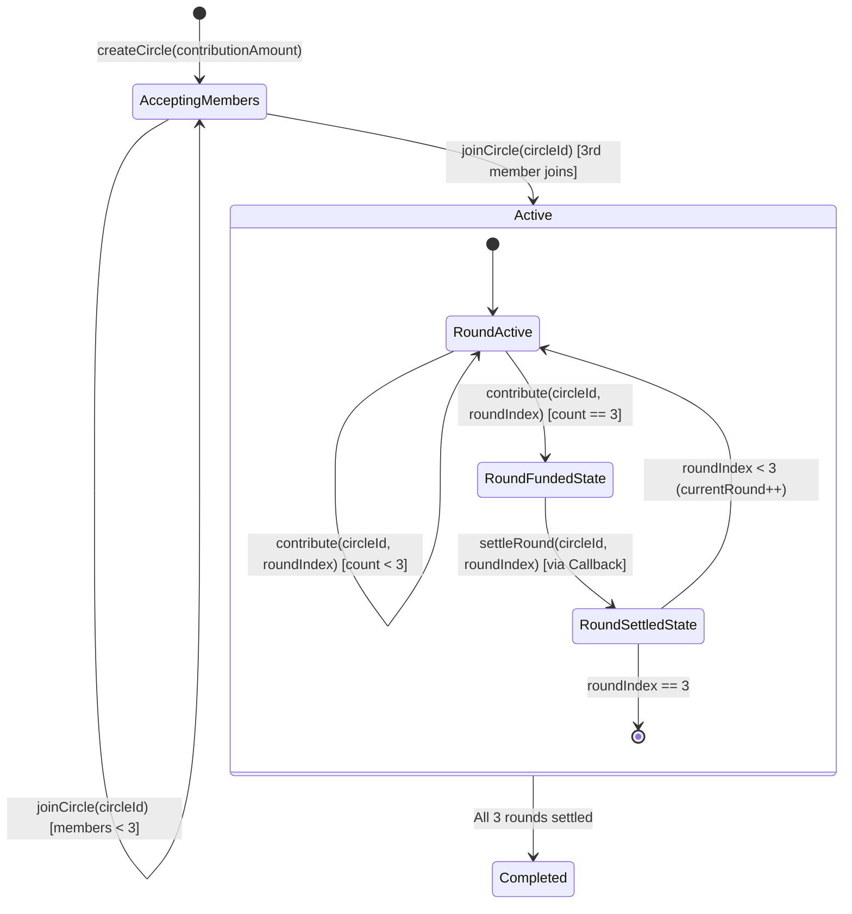

# AjoFlow Contract State Machine & Invariants

## 1. Circle Lifecycle State Machine



---

## 2. State Invariants & Rules

### A. Circle Invariants
1. **Immutable Fixed Order:** Upon the 3rd member joining, the member list is frozen. The payout recipient for round $R$ is permanently fixed to `members[R - 1]`.
2. **Deterministic Round Progression:** Contributions for round $R + 1$ are rejected until round $R$ has been settled (`isSettled == true`).
3. **No Duplicate Contributions:** A member can contribute exactly once per round.

### B. Round Invariants
1. **Quota Strictness:** A round transitions to `isFunded = true` if and only if `contributionsCount == maxMembers` (3).
2. **Single Payout Guarantee:** `settleRound(circleId, roundIndex)` checks `round.isSettled == false` before changing state and transferring tokens. Subsequent calls revert with `RoundAlreadySettled()`.
3. **Internal Solvency Calculation:** The payout sum is computed as `round.contributionTotal = maxMembers * contributionAmount`. No arbitrary balance or recipient can be injected through external calldata.

---

## 3. Data Structures & Types

```solidity
enum CircleState {
    AcceptingMembers,
    Active,
    Completed,
    Cancelled
}

struct Round {
    uint256 roundIndex;
    address recipient;
    uint256 contributionTotal;
    uint256 contributionsCount;
    bool isFunded;
    bool isSettled;
}

struct Circle {
    uint256 circleId;
    address creator;
    uint256 contributionAmount;
    uint256 maxMembers;
    uint256 currentRound;
    uint256 totalRounds;
    CircleState state;
    address[] members;
}
```

---

## 4. Custom Error Matrix

| Error | Condition |
| :--- | :--- |
| `UnauthorizedCaller()` | Caller is not the registered owner or settlementReceiver |
| `CircleDoesNotExist()` | `circle.circleId == 0` |
| `CircleNotAcceptingMembers()` | Attempting to join a circle not in `AcceptingMembers` state |
| `CircleNotActive()` | Calling contribute or settle when state is not `Active` |
| `CircleFull()` | Member array already at capacity (`maxMembers == 3`) |
| `AlreadyMember()` | Sender address is already registered in this circle |
| `NotMember()` | Non-member attempting to contribute to the circle |
| `InvalidRound()` | Contributing or settling a round index other than `currentRound` |
| `AlreadyContributed()` | Member has already submitted contribution for this round |
| `RoundNotFunded()` | Attempting settlement before all members have contributed |
| `RoundAlreadySettled()` | Duplicate settlement attempt |
| `InvalidAmount()` | `contributionAmount == 0` |
| `ZeroAddress()` | Passing zero address for critical dependencies |
