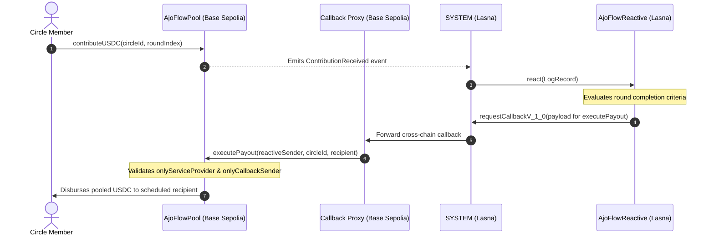

# AjoFlow Architecture Overview

AjoFlow is an autonomous, non-custodial Rotating Savings and Credit Association (ROSCA / Ajo / Esusu / Tanda) protocol designed for the **Set It and Forget It** track of the Reactive Omni Buildathon.

## 1. Background & Value Proposition

Traditional ROSCAs suffer from central coordinator risk, delayed manual distributions, and reliance on centralized off-chain keepers. AjoFlow decentralizes this financial primitive by leveraging **Reactive Omni**:
- **Base Sepolia:** Serves as the origin and destination settlement layer, handling member USDC contributions, vault accounting, and round payouts.
- **Reactive Lasna:** Serves as the autonomous reactive logic layer, subscribing directly to deposit events, monitoring cycle completion, and dispatching callback requests to trigger scheduled payouts.

## 2. Event-to-Callback Architecture Flow

## 3. UI Design Architecture

The protocol's user interface is mapped directly from the verified design layout (`docs/architecture/ui-reference.png`):
- **Dashboard / My Groups:** Overview of circles, cycle progress indicators, contribution deadlines, and quick contribute actions.
- **Group Detail:** Circle total balance, round progress stepper (e.g. Round 4 of 8), member payment counters (e.g. 4 of 6 paid), and schedule viewer.
- **Members Dashboard:** Live status breakdown (Paid, Late, Pending) providing transparent accountability.
