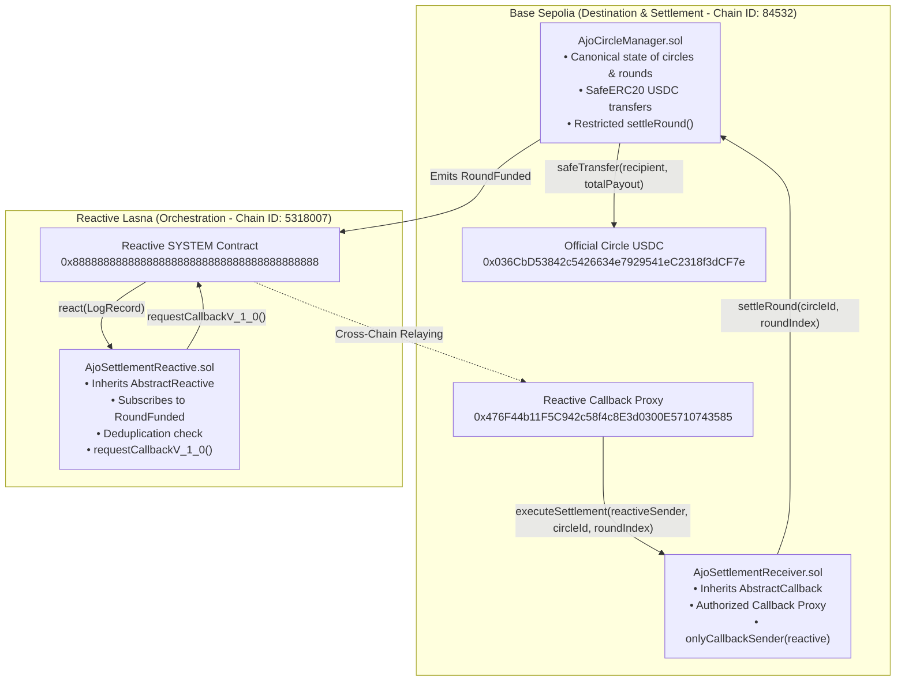

# AjoFlow Phase 2 Architecture Specification

## 1. System Topology & Contract Separation

AjoFlow decouples cross-chain reactive monitoring from core financial settlement across three distinct smart contracts:

---

## 2. Rationale for Three-Contract Architecture

### A. Critical Inheritance Incompatibility
Reactive Omni enforces two distinct base contracts:
1. `AbstractReactive`: Inherits `AbstractPayer` initialized with `SYSTEM` (`0x8888888888888888888888888888888888888888`) on Lasna.
2. `AbstractCallback`: Inherits `AbstractPayer` initialized with `callbackProxy_` (`0x476F44b11F5C942c58f4c8E3d0300E5710743585`) on destination chains (Base Sepolia).

These two base contracts cannot be combined into a single contract. Their service-provider interfaces, payment routing, and modifier configurations address different networks and environments.

### B. Decoupled Security Perimeter
By separating `AjoCircleManager` from `AjoSettlementReceiver`:
- `AjoCircleManager` has zero dependency on cross-chain infrastructure; its attack surface is restricted to ordinary ERC-20 transfers and caller authorization.
- `AjoSettlementReceiver` acts as an authenticated perimeter bridge. Even if the receiver contract were corrupted or redeployed, it cannot manipulate circle parameters, change round recipients, or withdraw funds arbitrarily. It can only signal `settleRound(circleId, roundIndex)` for rounds already verified as fully funded on-chain.

---

## 3. Network Interfaces & Addresses

| Network | Entity | Verified Address | Description |
| :--- | :--- | :--- | :--- |
| **Base Sepolia (84532)** | Circle USDC | `0x036CbD53842c5426634e7929541eC2318f3dCF7e` | Settlement asset (6 decimals) |
| **Base Sepolia (84532)** | Callback Proxy | `0x476F44b11F5C942c58f4c8E3d0300E5710743585` | Authorized callback execution relay |
| **Base Sepolia (84532)** | `AjoCircleManager` | `PENDING (Phase 3)` | Core state machine & vault |
| **Base Sepolia (84532)** | `AjoSettlementReceiver`| `PENDING (Phase 3)` | Callback receiver |
| **Reactive Lasna (5318007)** | System Contract | `0x8888888888888888888888888888888888888888` | Omni subscription & callback engine |
| **Reactive Lasna (5318007)** | `AjoSettlementReactive`| `PENDING (Phase 3)` | Event listener & callback requester |
