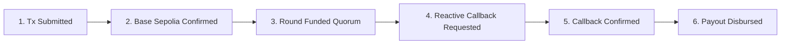

# AjoFlow Frontend-to-Contract Integration Specification

This document defines the client-side Web3 contract interfaces, transaction state lifecycles, and UI visual mappings for the AjoFlow frontend.

---

## 1. Visual Alignment with Design Reference

The frontend architecture directly adheres to the production layout in [`docs/architecture/ui-reference.png`](../architecture/ui-reference.png):
- **Screen 1 — My Groups Dashboard:** Displays circle cards, contribution progress bar (e.g., `4 of 6 paid` / `Member paid 2 of 3`), and `Contribute` trigger button.
- **Screen 2 — Circle Detail View:** Header metrics (total pool balance, next payout date), round progression stepper (rounds 1 through 3), and member preview pills.
- **Screen 3 — Members Roster:** Status pill badges for each participant:
  - 🟢 **Paid:** Member contribution confirmed for the active round.
  - 🔴 **Late / Unpaid:** Active round contribution pending from member.
  - ⚪ **Pending:** Subsequent rounds awaiting rotation.

---

## 2. Smart Contract Methods & Call Mappings

All frontend interactions target `AjoCircleManager` on Base Sepolia (`84532`):

### Write Methods
1. **`createCircle(uint256 contributionAmount)`**
   - Inputs: USDC amount scaled to 6 decimals (e.g., `$100` = `100_000_000`).
   - Prerequisites: None.
2. **`joinCircle(uint256 circleId)`**
   - Inputs: Target circle ID.
   - Status Transition: Transitions circle to `Active` when 3rd member joins.
3. **`contribute(uint256 circleId, uint256 roundIndex)`**
   - Prerequisites: ERC-20 `approve(circleManager, contributionAmount)` on Circle USDC (`0x036CbD53842c5426634e7929541eC2318f3dCF7e`).
   - Action: Submits member contribution for the specified round.

### View Methods
1. **`getCircle(uint256 circleId)`** returns `Circle` struct.
2. **`getRound(uint256 circleId, uint256 roundIndex)`** returns `Round` struct.
3. **`hasContributed(uint256 circleId, uint256 roundIndex, address member)`** returns boolean.

---

## 3. Granular Transaction Lifecycle States

To ensure transparency, the frontend distinguishes distinct operational states and never combines them into a single generic success notification:

| State Stage | On-Chain Event / Condition | UI Status Badge |
| :--- | :--- | :--- |
| **1. Contribution Submitted** | User signed `contribute()` in wallet | 🟡 *Submitting Transaction...* |
| **2. Base Sepolia Confirmed** | Transaction receipt confirmed on Base Sepolia | 🟢 *Contribution Recorded* |
| **3. Round Funded Quorum** | `RoundFunded` event emitted (3/3 contributions) | 🔵 *Round Quorum Reached* |
| **4. Reactive Callback Requested** | Reactive Lasna detects log and fires `requestCallbackV_1_0()` | 🟣 *Autonomous Reactive Trigger In Flight...* |
| **5. Callback Confirmed** | Callback Proxy executes on `AjoSettlementReceiver` | 🟢 *Settlement Callback Received* |
| **6. Payout Disbursed** | `RoundSettled` emitted; USDC credited to recipient | 🏆 *Round Payout Complete* |
